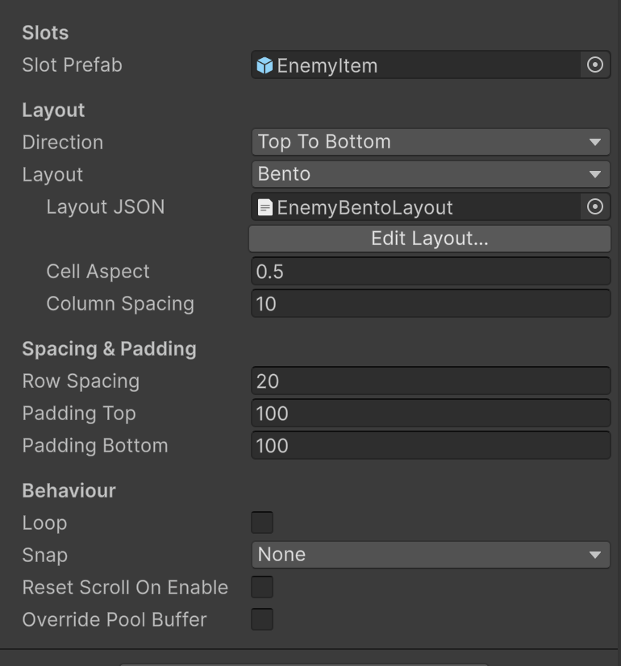

# API Reference

[← Back to README](../README.md)

- [Inspector](#inspector)
- [Methods and properties](#methods-and-properties)
- [Overridable on your list class](#overridable-on-your-list-class)
- [Events](#events)
- [Bento types](#bento-types)
- [Dependency injection](#dependency-injection)

---

## Inspector



Labels follow the direction: "Padding Top" in a top-to-bottom list, "Padding Left" in a left-to-right one. The `ScrollRect` settings underneath are hidden and driven by these. Settings are read-only while playing.

| Setting | Purpose |
|---|---|
| Slot Prefab | The prefab used for slots |
| Header Prefab | The prefab used for headers (sectioned lists only) |
| Direction | Top to bottom, bottom to top, left to right or right to left |
| Layout | List, Grid (a fixed count per line), Auto Grid (as many as fit) or Bento (tiles from a JSON layout) |
| Columns / Rows, Target size, Min, Max | Grid settings, shown for the chosen layout |
| Layout JSON, Edit Layout…, Cell Aspect | Bento settings: the layout file, a button that opens it in the [Bento Layout Editor](layouts.md#bento), and row height divided by column width (0.5 makes cells twice as wide as tall). Errors in the JSON are shown under the settings |
| Row Spacing / Column Spacing | Space between lines, and between slots on a line |
| Section Spacing | Space before every header except the first (sectioned lists only) |
| Header To Content Spacing | Space between each header and its section's first line (sectioned lists only) |
| Padding (start and end) | Space before the first line and after the last |
| Loop | Goes round forever, like a carousel. Lists and bento only, not grids or sections, and items don't expand |
| Snap | After a drag: **None** keeps scrolling freely, **Item** settles on the nearest item, **Page** moves one viewport at a time |
| Snap Align | With **Item**: whether the item lines up with the start, center or end of the viewport. Pages always line up with the start |
| Allow Multiple Expanded | Keeps more than one slot open (lists only) |
| Reset Scroll On Enable | Goes back to the start when the list is enabled again |
| Override Pool Buffer, Pool Buffer | How many slots to keep, as a multiple of the ones that fit on screen. The default is 1.4; raise it if fast flings show empty space |

## Methods and properties

| API | Purpose |
|---|---|
| `Initialize(source)` | Starts the list with a source |
| `SetSource(source)` | Replaces the source and refreshes (starts the list if needed) |
| `Refresh()` | Rebuilds from the current source |
| `Clear()` | Clears the shown slots and resets the scroll position |
| `ScrollToItem(index, align = Start, duration = 0, offset = 0)` | Scrolls to an item, at once or animated |
| `ScrollToStart(duration = 0)`, `ScrollToEnd(duration = 0)` | Scrolls to an end |
| `ForceStopScrolling()` | Stops any movement, including an animation or a snap |
| `Expand(index, size = -1)`, `Collapse(index)`, `SetExpandedSize(index, size = -1)` | Opens, closes or resizes a slot |
| `IsExpanded(index)`, `ExpandedCount` | Expansion state |
| `InvalidateSize(index)`, `InvalidateAllSizes()` | Measures again (measured slots) |
| `IsItemVisible(index)`, `VisibleStartIndex`, `VisibleEndIndex`, `IsFirstItemVisible`, `IsLastItemVisible` | What's on screen |
| `GetItemCount()`, `IsInitialized`, `IsScrolling`, `IsDragging` | State |
| `GetItemOffset(index)`, `GetItemSize(index)` | Where an item starts along the scroll axis, and its size (its line's in a grid, its tile's in bento); -1 if unknown |
| `ViewportSize`, `ContentSize` | Sizes along the scroll axis |
| `SetBentoLayout(layout)`, `GetTile(index)` | Bento: the layout, and an item's tile (counted from its section in a sectioned list) |
| `GetViewportPosition(index)` | Where a shown item sits in the viewport: 0 centre, ±0.5 edges, NaN when not shown. Slots can implement `IViewportPositionListener` to be told instead |
| `Settings`, `SlotPrefab` | Settings and prefab, read before `Initialize` |

`SectionedScroller<TItem, THeader>` has the same API, plus `SetSource(SectionedSource)`, `SetSource(ISectionedSourceProvider)`, `ScrollToSection(section, duration = 0)`, `Source` and `HeaderPrefab`. It has no `Initialize`: `SetSource` starts it.

## Sources and slots

The exact signatures, all in the namespace `UIScroller`. `TItem`, `THeader` and `T` are classes.

```csharp
// The lists. Declare one concrete, empty subclass per data type: public class ShopScroller : Scroller<ShopItem> { }
public abstract class Scroller<T> : ScrollerBase where T : class;
public abstract class SectionedScroller<TItem, THeader> : ScrollerBase where TItem : class where THeader : class;
public abstract partial class ScrollerBase : ScrollRect, IScroller   // Refresh(), SetBentoLayout()... (Methods and properties)

public interface IItemSource<T>
{
    int ItemCount { get; }
    T GetItem(int index);
    IReadOnlyList<T> GetAllItems();
}

public interface IItemSourceProvider<T>
{
    IItemSource<T> GetSource();
}

public class ListSource<T> : IItemSource<T>
{
    public ListSource(IEnumerable<T> initialItems = null);
    public void AddItem(T item);
    public void AddItems(IEnumerable<T> newItems);
    public void InsertItem(int index, T item);
    public void RemoveItem(T item);
    public void RemoveItemAt(int index);
    public void Clear();
    public void SetItems(IEnumerable<T> newItems);      // null items are filtered out, with a warning
    public void ReplaceItems(IEnumerable<T> newItems);  // same as SetItems
}

public sealed class SectionedSource<TItem, THeader>
{
    public event Action Changed;                 // a section added, inserted or removed, a clear, or Recount finding a change
    public bool SkipEmptySections { get; set; }  // true by default: an empty section shows nothing, not even its header
    public int SectionCount { get; }             // including skipped empty sections
    public int Count { get; }                    // entries shown: headers plus items
    public void AddSection(THeader header, IItemSource<TItem> items);
    public void InsertSection(int sectionIndex, THeader header, IItemSource<TItem> items);
    public void RemoveSection(int sectionIndex);
    public void ClearSections();
    public void Recount();                       // picks up item count changes in the inner sources
    public EntryKind KindAt(int flatIndex);      // EntryKind.Header or EntryKind.Item
    public THeader HeaderAt(int flatIndex);
    public TItem ItemAt(int flatIndex);
    public (int section, int indexInSection) Locate(int flatIndex);
    public int FlatIndexOf(int sectionIndex, int indexInSection);
}

public interface ISectionedSourceProvider<TItem, THeader>
{
    SectionedSource<TItem, THeader> GetSource();
}

public interface ISlot
{
    float DefaultExtent { get; }   // > 0 fixed size, <= 0 measured
}

public interface ISlot<T> : ISlot, ToolsCore.IInstantiable
{
    T Data { get; set; }
}

// In Tools Core (assembly ToolsCore): a marker with no members. Implementing ISlot<T> needs the ToolsCore reference.
namespace ToolsCore { public interface IInstantiable { } }
```

`SectionedScroller.SetSource(provider)` is `SetSource(provider.GetSource())`: it reads the source once. `SetSource` calls `Recount()` and needs the **Header Prefab** assigned, implementing `ISlot<THeader>`; items use the **Slot Prefab** (`ISlot<TItem>` or `IExpandableSlot<TItem>`). A header takes a whole row in a grid. Indexes in the list's API (`ScrollToItem`, `Expand`...) count headers: use the source's `FlatIndexOf` to find an item's entry.

The list doesn't subscribe to `SectionedSource.Changed`, and inner sources don't announce their changes: after changing a section or a `ListSource` inside it, call the list's `Refresh()`.

## Overridable on your list class

| Member | Purpose |
|---|---|
| `BindItem(SlotHandle slot, int index)` | Shows an item in a slot (the default sets `Data` and `IsExpanded`) |
| `OnPullToRefreshDetected()` | The user pulled past the start |
| `OnPaginationThresholdReached()`, `SupportsPagination()` | Paging hooks |
| `DataSource`, `HasReachedLastPage` | The current source, and whether paging reached its end |

## Events

All are read-only notifications.

| Event | Raised when |
|---|---|
| `OnInitialized` | Initialization finished, inside `Initialize` (subscribe first) |
| `ItemExpanded(int)`, `ItemCollapsed(int)` | An item opened or closed (a closed one is raised before the next one's open) |
| `Rebuilt` | The list rebuilt its lines (`Refresh`, `SetSource`, a change of columns) |
| `ContentSizeChanged(float)` | The list changed Content's size (measuring, expanding, pages, Refresh), not when scrolling |
| `SnappedTo(int)` | The list settled on an item after a drag |
| `PageRequested`, `PageLoaded(int)`, `PageFailed(Exception)`, `ReachedEnd` | Paging |

## Bento types

| Type | Purpose |
|---|---|
| `BentoLayout` | `FromJson`, `FromData`, `FromSpans`, `FromPatterns`, `Uniform`; `Columns`, `IsValid`, `Errors`, `MaxRowSpan` |
| `BentoSpan`, `BentoTile`, `BentoPattern` | A tile's size, a tile's place, a block of tiles |
| `BentoLayoutData` and friends | The JSON form, for `JsonUtility` or any other JSON library |

## Dependency injection

The list works without a container, using `Instantiate`. With [Fast IoC](https://github.com/sgonzalezrozo/unity-fast-ioc), its instantiator can be injected. The `UIScroller` assembly exposes its internals to `Assembly-CSharp`, so Fast IoC `0.4.0` and later assign the instantiator directly, without reflection, including on subclasses in your project. Other containers connect through [Tools Core](https://github.com/sgonzalezrozo/unity-tools-core).
