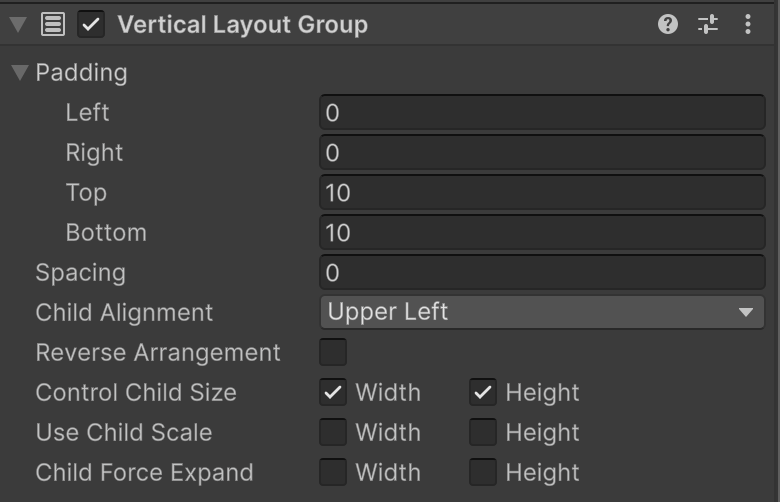

# Data & Sizes

[← Back to README](../README.md)

- [Data and updates](#data-and-updates)
- [Item sizes](#item-sizes)
- [Filtering](#filtering)

---

## Data and updates

Full example: [Updating items at runtime](examples.md#updating-items-at-runtime).

A list reads its items from a source (`IItemSource<T>`). Change the source, then call `Refresh()`:

```csharp
source.AddItem(new InventoryItem { Name = "New item" });
list.Refresh();
```

- `ListSource<T>` also has `AddItems`, `InsertItem`, `RemoveItem`, `RemoveItemAt`, `SetItems`, `ReplaceItems` and `Clear`.
- `SetSource(newSource)` switches to another source. It also works before `Initialize` (it calls it).
- `Refresh()` with the same item count rebinds the slots in place, keeps expanded items and allocates nothing.
- To build the source elsewhere (a screen's Model, for example), implement `IItemSourceProvider<T>` and pass its `GetSource()`.

For data that arrives in pages, see [Paging](scrolling.md#paging).

## Item sizes

Full examples: [fixed-size slots](examples.md#simple-list-with-fixed-size-slots) and [slots that size themselves](examples.md#slots-that-size-themselves).

Each slot decides how big it is through `DefaultExtent` (the height in a vertical list, the width in a horizontal one):

- **A positive number is a fixed size.** Nothing is measured, not even a layout group on the slot: every item gets exactly that size. This is the fastest option.
- **0 or less (for example `-1`) measures the slot with Unity's layout.** Text, localized strings and images decide each item's size.

A slot with a layout group that should grow with its content needs `-1`. With `80`, it stays 80 px.

### Building a slot that sizes itself

- Return `-1` from `DefaultExtent`.
- On the prefab's root, add a `VerticalLayoutGroup` (a `HorizontalLayoutGroup` in a horizontal list). These settings work for a vertical list:

  | Setting | Value |
  |---|---|
  | Child Alignment | Upper Left or Upper Center |
  | Control Child Size | **Width** and **Height** on |
  | Use Child Scale | Width and Height off |
  | Child Force Expand | Width and Height off |

  

  Padding and spacing are counted in the measured height.
  **Control Child Size > Height** is the one that lets the list read the slot's height (**Width** in a horizontal list); with it off, the slot keeps the prefab's size. **Child Force Expand > Height** on stretches children to fill the slot instead of fitting them.
- Inside it, use text with wrapping on, images with a `LayoutElement` or an `AspectRatioFitter`, and nested layout groups.
- **Don't put a `ContentSizeFitter` on the root.** The list sets the root's size, and a fitter would fight it. Fitters on children are fine.
- The list always sets the width: the full width in a list, the column width in a grid. That's what makes text wrap correctly.

If the root reports no preferred size (no layout group), the slot keeps the prefab's size and the list logs one warning.

### How measuring works

- A slot is measured when it's first shown. Items not measured yet use the average of the measured ones.
- **Sizes are cached:** an item scrolled back into view reuses its size, with no layout rebuild. `Refresh()` measures the items on screen again.
- **Late changes are followed.** A string that arrives late, an image that finishes loading, or a child turned on or off resizes the slot one frame later. The list adds a `SlotSizeWatcher` to measured slots by itself.
- **What you're looking at stays still.** Items measured for the first time while you scroll up grow upwards, and an item whose content changed keeps its start and pushes the ones after it. This also holds mid-drag, with no jump and no extra speed.
- In a grid, a row is as tall as its tallest slot.

When a size depends on something the slot can't notice, ask for a new measurement:

```csharp
list.InvalidateSize(index); // this item
list.InvalidateAllSizes();  // every item
```

Items on screen are measured at once, the others when they're shown. `InvalidateAllSizes()` is called for you when the list's width changes and, with Unity Localization installed, when the language changes. Both do nothing for fixed sizes.

## Filtering

Full example: [Search and filter](examples.md#search-and-filter).

Wrap a source in a `FilteredSource<T>`:

```csharp
FilteredSource<InventoryItem> filtered = new(items, item => item.Name.Contains("Sword"));
list.Initialize(filtered);

filtered.SetPredicate(item => item.Name.StartsWith("A"));
list.Refresh();
```

The matching items are worked out once and cached. `SetPredicate` and `ClearPredicate` work them out again; call `Invalidate()` after the underlying source changes.
