# Examples

[← Back to README](../README.md)

Step-by-step setups for every kind of list, from the simplest to nested carousels. Each one has the scripts, how to build the slot prefab and the scene, and a picture of the Inspector. The orange numbers on each picture match the numbered steps under it.

The snippets use TextMeshPro (`TMP_Text`) for labels and assume `using UIScroller;`. The **Examples** sample in the Package Manager builds several of these in code, so you can press Play before building your own. To start a list of your own with its scripts and prefabs already made, use **UI Scroller > New Scroll List** in the Project window (see [Create a list from the Assets menu](getting-started.md#create-a-list-from-the-assets-menu)).

**Lists**
- [Simple list with fixed-size slots](#simple-list-with-fixed-size-slots)
- [Slots that size themselves](#slots-that-size-themselves)
- [Horizontal list](#horizontal-list)

**Grids and bento**
- [Grid with fixed columns](#grid-with-fixed-columns)
- [Auto grid](#auto-grid)
- [Bento store](#bento-store)

**Data**
- [Several sources in one list (sections)](#several-sources-in-one-list-sections)
- [Switching between sources (tabs)](#switching-between-sources-tabs)
- [Infinite scroll with paging](#infinite-scroll-with-paging)
- [Search and filter](#search-and-filter)
- [Updating items at runtime](#updating-items-at-runtime)

**Interaction**
- [Expandable rows](#expandable-rows)
- [Looping carousel](#looping-carousel)
- [Carousels inside a vertical list](#carousels-inside-a-vertical-list)

---

## Simple list with fixed-size slots

**Use it when** every row has the same height: an inventory, a leaderboard, a settings list. It's the fastest setup, because nothing is measured.

Every list is made of the same four parts: an **item** class with your data, a **slot** that shows one item, a **list** class, and a few lines that give the list its items.

### 1. The item

Items are plain classes (not structs):

```csharp
public class InventoryItem
{
    public string Name;
    public int Count;
}
```

### 2. The slot

The slot shows one item. It's reused as you scroll, so the `Data` setter must reset everything it shows:

```csharp
using TMPro;
using UIScroller;
using UnityEngine;

public class InventorySlot : MonoBehaviour, ISlot<InventoryItem>
{
    [SerializeField] private TMP_Text nameLabel;
    [SerializeField] private TMP_Text countLabel;

    private InventoryItem data;

    // A fixed height: every row is 80 px, and nothing is measured.
    public float DefaultExtent => 80f;

    public InventoryItem Data
    {
        get => data;
        set
        {
            data = value;
            nameLabel.text = value.Name;
            countLabel.text = $"x{value.Count}";
        }
    }
}
```

**Build the prefab:** a UI GameObject with a `RectTransform` and the `InventorySlot` component on its root, an `Image` for the background, and two TextMeshPro texts as children. Assign the texts to the slot's fields and save it as a prefab. Its root size doesn't matter: the list sets the width, and `DefaultExtent` sets the height.

### 3. The list class

Unity can't add a generic component, so make a concrete one. It can stay empty:

```csharp
using UIScroller;

public class InventoryList : Scroller<InventoryItem>
{
}
```

### 4. The scene

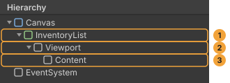

1. Under your Canvas, create an empty UI GameObject, name it `InventoryList`, and give it the size and anchors the list should have on screen. Add the `InventoryList` component to it.
2. Adding the component builds a stretched **Viewport**, with a `RectMask2D` that clips slots, a nested `Canvas` so scrolling only rebatches the list, and a `GraphicRaycaster` so buttons in slots get clicks.
3. It also builds **Content** inside the Viewport. Leave Content without layout components (`ContentSizeFitter`, `LayoutGroup`, `LayoutElement`): the list sets its size. If one is added, the Inspector shows a **Remove Layout Components** button.

Don't start from Unity's **UI > Scroll View**: it adds scrollbars, a stencil `Mask` and an `Image` the list doesn't use.

### 5. The Inspector

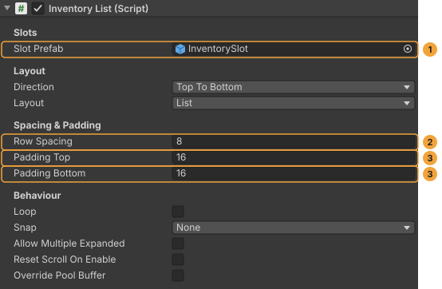

1. **Slot Prefab:** drag in the `InventorySlot` prefab.
2. **Row Spacing:** the space between rows, 8 here.
3. **Padding Top** and **Padding Bottom:** space before the first row and after the last.

The rest can keep its defaults. The labels follow the direction: in a horizontal list they read Column Spacing, Padding Left and Padding Right.

### 6. Give it items

```csharp
using System.Collections.Generic;
using UIScroller;
using UnityEngine;

public class InventoryScreen : MonoBehaviour
{
    [SerializeField] private InventoryList list;

    private void Start()
    {
        List<InventoryItem> items = new();
        for (int i = 0; i < 10_000; i++)
            items.Add(new InventoryItem { Name = $"Item {i}", Count = i % 99 + 1 });

        list.Initialize(new ListSource<InventoryItem>(items));
    }
}
```

Press Play: ten thousand rows scroll as cheaply as ten, because only the rows on screen (plus a small buffer) exist.

**Notes**
- Subscribe to `OnInitialized` before calling `Initialize`: it fires inside it, with the first screen already shown.
- The list must be active when you call `Initialize`.
- To change the items later, see [Updating items at runtime](#updating-items-at-runtime).

## Slots that size themselves

**Use it when** rows hold text of different lengths: chat messages, item descriptions, localized strings, news. Each slot is measured with Unity's layout once, and the size is cached.

### The item and the slot

The only change from a fixed slot is `DefaultExtent`: return `-1` (any value of 0 or less) to measure.

```csharp
using TMPro;
using UIScroller;
using UnityEngine;

public class Message
{
    public string Author;
    public string Text;
}

public class MessageSlot : MonoBehaviour, ISlot<Message>
{
    [SerializeField] private TMP_Text author;
    [SerializeField] private TMP_Text body;

    private Message data;

    // 0 or less: measure this slot with its layout group.
    public float DefaultExtent => -1f;

    public Message Data
    {
        get => data;
        set
        {
            data = value;
            author.text = value.Author;
            body.text = value.Text;
        }
    }
}

public class MessageList : Scroller<Message>
{
}
```

### Build the prefab

1. On the slot's root, add a **Vertical Layout Group** with these settings:

   | Setting | Value |
   |---|---|
   | Child Alignment | Upper Left or Upper Center |
   | Control Child Size | **Width** and **Height** on |
   | Use Child Scale | Width and Height off |
   | Child Force Expand | Width and Height off |

   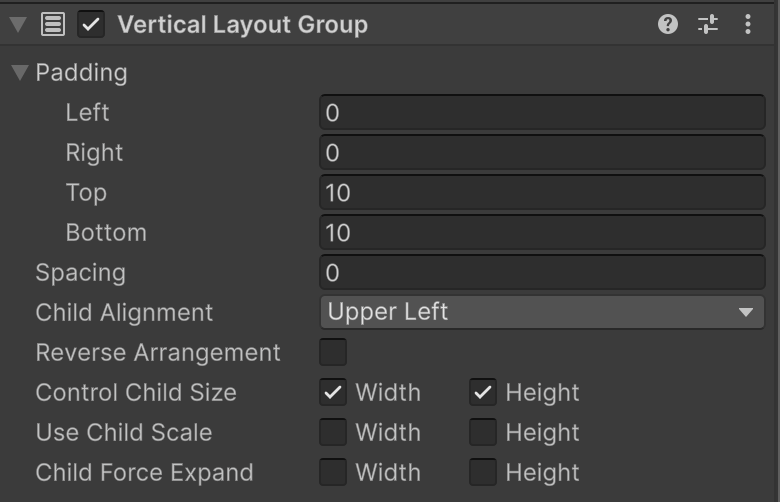

2. Add the two texts as children, with **Wrapping** on. Padding and spacing on the layout group count in the height.
3. **Don't add a `ContentSizeFitter` to the root**: the list sets the root's size, and a fitter would fight it. Fitters on children are fine.

**Control Child Size > Height** is what lets the list read the height. With it off, every slot keeps the prefab's size and the list logs one warning.

### The Inspector

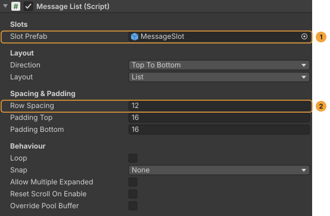

1. **Slot Prefab:** the `MessageSlot` prefab.
2. **Row Spacing:** 12, to keep messages apart.

The scene is built as in the [first example](#4-the-scene). Start it the same way, with `list.Initialize(new ListSource<Message>(messages))`.

**Notes**
- Text that arrives late, such as a localized string or a downloaded image, resizes its slot one frame later, without code. What's on screen doesn't jump, even mid-drag.
- When a size depends on something the slot can't see, call `list.InvalidateSize(index)` or `list.InvalidateAllSizes()`.
- More detail: [Item sizes](data-and-sizes.md#item-sizes).

## Horizontal list

**Use it when** items scroll sideways: a row of heroes, a strip of rewards, a level select.

The slot's `DefaultExtent` is now its **width**. The list sets the height to fill the list.

```csharp
using TMPro;
using UIScroller;
using UnityEngine;
using UnityEngine.UI;

public class Hero
{
    public string Name;
    public Sprite Portrait;
}

public class HeroSlot : MonoBehaviour, ISlot<Hero>
{
    [SerializeField] private Image portrait;
    [SerializeField] private TMP_Text nameLabel;

    private Hero data;

    public float DefaultExtent => 220f; // the width of each card

    public Hero Data
    {
        get => data;
        set
        {
            data = value;
            portrait.sprite = value.Portrait;
            nameLabel.text = value.Name;
        }
    }
}

public class HeroList : Scroller<Hero>
{
}
```

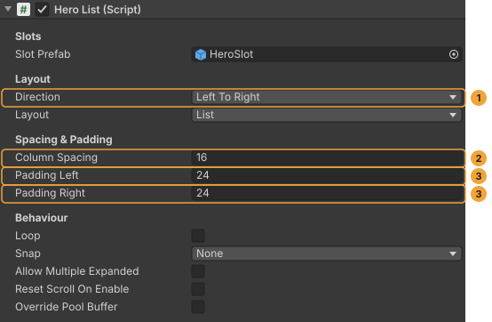

1. **Direction:** Left To Right. Right To Left starts from the right edge instead.
2. **Column Spacing:** the space between cards, 16. In a horizontal list, rows become columns.
3. **Padding Left** and **Padding Right:** 24 each.

Give the list GameObject a wide, short rectangle, such as the full width and 300 px tall, then call `list.Initialize(new ListSource<Hero>(heroes))`.

**Notes**
- Bottom To Top works the same way vertically: the first item sits at the bottom, as in a chat.
- To make a horizontal list a carousel that snaps and loops, see [Looping carousel](#looping-carousel).

## Grid with fixed columns

**Use it when** items are cards in a fixed number of columns: 3 cards per row on every screen.

Use the same item and slot as a list. In a grid the list sets each slot's **width** from the columns, and `DefaultExtent` is the row height:

```csharp
public class CardSlot : MonoBehaviour, ISlot<Card>
{
    // ...fields and Data setter as in a list...
    public float DefaultExtent => 260f; // row height; the width comes from the columns
}

public class CardGrid : Scroller<Card>
{
}
```

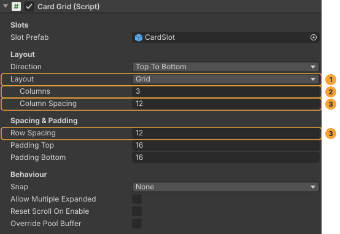

1. **Layout:** Grid. Choosing it shows the grid's own fields under it.
2. **Columns:** 3. Slots stretch to share the width.
3. **Column Spacing** and **Row Spacing:** 12 each, the gaps between cards and between rows.

Start it with `grid.Initialize(new ListSource<Card>(cards))`.

**Notes**
- A row is as tall as its tallest slot when slots are measured (`DefaultExtent` of `-1`).
- From code, before `Initialize`: `grid.Settings.slotsPerLine = 3;`.
- Grids don't loop or expand.

## Auto grid

**Use it when** the number of columns should follow the screen: 2 on a phone, 5 on a tablet.

Same scripts as the [fixed grid](#grid-with-fixed-columns), different Layout:

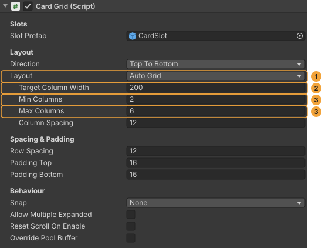

1. **Layout:** Auto Grid.
2. **Target Column Width:** 200. The list fits as many columns of about this width as the list's width allows.
3. **Min Columns** and **Max Columns:** 2 and 6, so a narrow phone still shows 2 and a wide tablet stops at 6.

**Notes**
- Columns are worked out again when the list's width changes, for example when the device rotates.
- From code, before `Initialize`: `grid.Settings.autoSlotsPerLine = true; grid.Settings.targetSlotSize = 200f;` plus `minSlotsPerLine` and `maxSlotsPerLine`.

## Bento store

**Use it when** tiles have different sizes: a big featured offer next to small ones, as in a store.

The tile sizes come from a **layout**, not from the items. Write it once in JSON, or draw it in the **Bento Layout Editor**.

### The layout

This one has 4 columns. The first block is a 2 x 2 featured tile, a 2 x 1 tile and two 1 x 1 tiles; after it, rows of four 1 x 1 tiles repeat (`repeatFrom: 1`):

```json
{
  "columns": 4,
  "repeatFrom": 1,
  "patterns": [
    { "rows": 2, "tiles": [ {"c":0,"r":0,"w":2,"h":2}, {"c":2,"r":0,"w":2,"h":1}, {"c":2,"r":1,"w":1,"h":1}, {"c":3,"r":1,"w":1,"h":1} ] },
    { "rows": 1, "tiles": [ {"c":0,"r":0,"w":1,"h":1}, {"c":1,"r":0,"w":1,"h":1}, {"c":2,"r":0,"w":1,"h":1}, {"c":3,"r":0,"w":1,"h":1} ] }
  ]
}
```

Save it as `ShopBentoLayout.json` in your project: Unity imports it as a TextAsset.

### The slot

A bento slot stretches to its tile, so `DefaultExtent` isn't used for its size. Make the slot's content stretch with its root:

```csharp
using TMPro;
using UIScroller;
using UnityEngine;
using UnityEngine.UI;

public class Offer
{
    public string Title;
    public Sprite Art;
    public int Price;
}

public class ShopTile : MonoBehaviour, ISlot<Offer>
{
    [SerializeField] private Image art;
    [SerializeField] private TMP_Text title;
    [SerializeField] private TMP_Text price;

    private Offer data;

    public float DefaultExtent => 100f; // not used for bento tiles: the layout sizes them

    public Offer Data
    {
        get => data;
        set
        {
            data = value;
            art.sprite = value.Art;
            title.text = value.Title;
            price.text = value.Price.ToString();
        }
    }
}

public class ShopList : Scroller<Offer>
{
}
```

### The Inspector

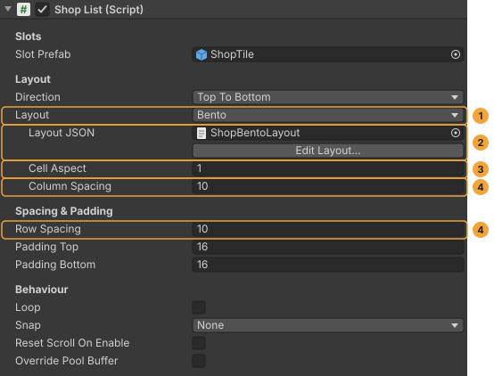

1. **Layout:** Bento.
2. **Layout JSON:** drag in `ShopBentoLayout`. **Edit Layout…** opens it in the Bento Layout Editor (also under **Window > UI Scroller**), where you draw each pattern's tiles on a grid and see the first items placed. With no JSON yet, **New Layout…** creates one.
3. **Cell Aspect:** row height divided by column width. 1 makes square cells; 0.5 makes them twice as wide as tall.
4. **Column Spacing** and **Row Spacing:** the gaps between tiles, 10 each.

Start it with `shop.Initialize(new ListSource<Offer>(offers))`.

**Notes**
- If the JSON has errors, the Inspector lists them and items are placed as 1 x 1 tiles.
- From code: `shop.SetBentoLayout(BentoLayout.FromJson(json));`, before or after `Initialize`.
- Bento works with [paging](#infinite-scroll-with-paging), [sections](#bento-sections) and [looping](scrolling.md#bento-carousels). Tiles don't expand.
- The layout format, spans and patterns: [Bento](layouts.md#bento).

## Several sources in one list (sections)

**Use it when** one list shows several groups, each with a header and its own items: Weapons, Armour, Potions. Each section has its **own source**, so you can update one group without touching the others.

### The scripts

You need a header class, a header slot, and a list that derives from `SectionedScroller<TItem, THeader>`. Items use the slot from the [first example](#simple-list-with-fixed-size-slots).

```csharp
using TMPro;
using UIScroller;
using UnityEngine;

public class InventorySection
{
    public string Title;
}

// On the Header Prefab. -1 measures it, so a header can be as tall as its text.
public class InventoryHeaderSlot : MonoBehaviour, ISlot<InventorySection>
{
    [SerializeField] private TMP_Text title;

    private InventorySection data;

    public float DefaultExtent => -1f;

    public InventorySection Data
    {
        get => data;
        set
        {
            data = value;
            title.text = value.Title;
        }
    }
}

public class InventorySectionsList : SectionedScroller<InventoryItem, InventorySection>
{
}
```

Build the header prefab like the [measured slot](#build-the-prefab), with a Vertical Layout Group, or give it a fixed `DefaultExtent`.

### The Inspector

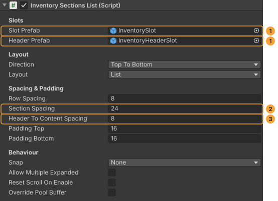

1. **Slot Prefab** and **Header Prefab:** the item slot and the header slot. A sectioned list shows the Header Prefab field.
2. **Section Spacing:** 24, extra space before every header except the first.
3. **Header To Content Spacing:** 8, between a header and its first row.

### Build the sections

One `ListSource` per section:

```csharp
using System.Collections.Generic;
using UIScroller;
using UnityEngine;

public class SectionsScreen : MonoBehaviour
{
    [SerializeField] private InventorySectionsList list;

    private ListSource<InventoryItem> potions;

    public void Show(List<InventoryItem> weapons, List<InventoryItem> armour, List<InventoryItem> potionItems)
    {
        potions = new ListSource<InventoryItem>(potionItems);

        SectionedSource<InventoryItem, InventorySection> source = new();
        source.AddSection(new InventorySection { Title = "Weapons" }, new ListSource<InventoryItem>(weapons));
        source.AddSection(new InventorySection { Title = "Armour" }, new ListSource<InventoryItem>(armour));
        source.AddSection(new InventorySection { Title = "Potions" }, potions);

        list.SetSource(source); // starts the list the first time; replaces the sections after that
    }

    // Change one section's items, then refresh.
    public void AddPotion(InventoryItem potion)
    {
        potions.AddItem(potion);
        list.Refresh();
    }
}
```

**Notes**
- A sectioned list has no `Initialize`: `SetSource` starts it.
- Empty sections are hidden with their header. Set `source.SkipEmptySections = false` to keep the header.
- `list.ScrollToSection(2, 0.3f)` scrolls to a header. Indexes in the list's API count headers too: `source.FlatIndexOf(section, indexInSection)` turns a section and item into a list index.
- `InsertSection`, `RemoveSection` and `ClearSections` change the sections themselves.
- A sectioned list doesn't page or loop.

### Bento sections

Sections also work with bento: each header takes a whole row, and the layout starts again in every section.

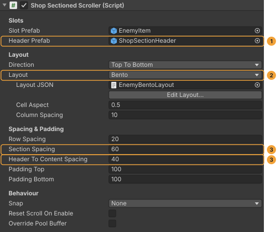

1. **Header Prefab:** the header slot, as in a list.
2. **Layout:** Bento, with its Layout JSON, Cell Aspect and Column Spacing as in the [bento store](#bento-store).
3. **Section Spacing** and **Header To Content Spacing:** 60 and 40 here, for more air between groups.

The code is the same as above: a `SectionedScroller` and a `SectionedSource` with one source per section. A tall tile never reaches into the next section.

## Switching between sources (tabs)

**Use it when** one list shows different data depending on a tab or filter button: All, Weapons, Potions.

Keep one source per tab, and pass the chosen one to `SetSource`. `SetSource` keeps the scroll position, so scroll back to the start for a new tab:

```csharp
using System.Collections.Generic;
using UIScroller;
using UnityEngine;

public class InventoryTabs : MonoBehaviour
{
    [SerializeField] private InventoryList list;

    private ListSource<InventoryItem> all;
    private ListSource<InventoryItem> weapons;
    private ListSource<InventoryItem> potions;

    public void Load(List<InventoryItem> allItems, List<InventoryItem> weaponItems, List<InventoryItem> potionItems)
    {
        all = new ListSource<InventoryItem>(allItems);
        weapons = new ListSource<InventoryItem>(weaponItems);
        potions = new ListSource<InventoryItem>(potionItems);
        list.SetSource(all); // starts the list the first time
    }

    // Hook these up to the tab buttons.
    public void ShowAll() => Show(all);
    public void ShowWeapons() => Show(weapons);
    public void ShowPotions() => Show(potions);

    private void Show(ListSource<InventoryItem> tab)
    {
        list.SetSource(tab);
        list.ScrollToStart();
    }
}
```

The list and its Inspector are the ones from the [first example](#5-the-inspector).

**Notes**
- `SetSource` also closes expanded slots.
- To narrow one big list instead of keeping several, see [Search and filter](#search-and-filter).
- To remember each tab's position, save `list.VisibleStartIndex` before switching and call `list.ScrollToItem(saved)` after.

## Infinite scroll with paging

**Use it when** items come from a server in pages: a feed, a mail box, a store catalogue. The list asks for the next page by itself as you get near the end.

### The page loader

Implement `IPageLoader<T>`. Pages start at 0. Return the items and whether there are more; throw to report a failure:

```csharp
using System.Collections.Generic;
using System.Threading;
using System.Threading.Tasks;
using UIScroller;

public class FeedPost
{
    public string Title;
}

public class FeedPageLoader : IPageLoader<FeedPost>
{
    private const int PageSize = 30;
    private const int PageCount = 5;

    public async Task<PageResult<FeedPost>> LoadAsync(int page, CancellationToken cancellation)
    {
        await Task.Delay(600, cancellation); // your web request goes here

        List<FeedPost> posts = new(PageSize);
        for (int i = 0; i < PageSize; i++)
            posts.Add(new FeedPost { Title = $"Post {page * PageSize + i}" });

        bool hasMore = page + 1 < PageCount;
        return new PageResult<FeedPost>(posts, hasMore);
    }
}
```

### The list, with pull to refresh

`OnPullToRefreshDetected` runs when the user releases a drag more than 75 px past the start. Starting the source again from page 0 refreshes the feed:

```csharp
using UIScroller;

public class FeedList : Scroller<FeedPost>
{
    protected override void OnPullToRefreshDetected()
    {
        if (DataSource is IPagedSource<FeedPost> paged)
            paged.Reset();
    }
}
```

The slot is a normal `ISlot<FeedPost>`, fixed or [measured](#slots-that-size-themselves).

### The Inspector


1. **Slot Prefab:** the `FeedSlot` prefab. Nothing else is specific to paging: it comes from the source.

### Start it and show its state

```csharp
using UIScroller;
using UnityEngine;
using TMPro;

public class FeedScreen : MonoBehaviour
{
    [SerializeField] private FeedList list;
    [SerializeField] private TMP_Text status;

    private void Start()
    {
        list.PageRequested += () => status.text = "Loading…";
        list.PageLoaded += count => status.text = $"{list.GetItemCount()} posts";
        list.PageFailed += exception => status.text = exception.Message;
        list.ReachedEnd += () => status.text = "You're all caught up";

        list.SetSource(new PagedSource<FeedPost>(new FeedPageLoader()));
    }
}
```

**Notes**
- The first page loads as soon as the source is set. The next one loads when fewer than 10 items are left after the last visible one.
- New pages are appended without a rebuild: the scroll position and expanded slots stay.
- One page loads at a time. Changing the source or destroying the list cancels a load in flight: the loader's token is cancelled.
- The **Extras** sample has a `PullIndicator` (a label and spinner you drive from these events) and an `EmptyStatePanel`.
- A looping list loads only the first page. A sectioned list doesn't page.

## Search and filter

**Use it when** a search box or a filter narrows a long list without rebuilding your data.

Wrap the source in a `FilteredSource<T>`. Change its predicate, then refresh:

```csharp
using System.Collections.Generic;
using TMPro;
using UIScroller;
using UnityEngine;

public class InventorySearch : MonoBehaviour
{
    [SerializeField] private InventoryList list;
    [SerializeField] private TMP_InputField searchField;

    private FilteredSource<InventoryItem> filtered;

    public void Load(List<InventoryItem> items)
    {
        filtered = new FilteredSource<InventoryItem>(new ListSource<InventoryItem>(items));
        list.Initialize(filtered);
        searchField.onValueChanged.AddListener(OnSearchChanged);
    }

    private void OnSearchChanged(string text)
    {
        if (string.IsNullOrEmpty(text))
            filtered.ClearPredicate();
        else
            filtered.SetPredicate(item => item.Name.Contains(text, System.StringComparison.OrdinalIgnoreCase));

        list.Refresh();
        list.ScrollToStart();
    }
}
```

The list and its Inspector are the ones from the [first example](#5-the-inspector).

**Notes**
- The matching items are worked out once and cached until the predicate changes.
- When the underlying `ListSource` changes, call `filtered.Invalidate()` before `Refresh()`.

## Updating items at runtime

**Use it when** items are added, removed or changed while the list is on screen: a new chat message, a sold item, a renamed hero.

Change the `ListSource`, then call `Refresh()`:

```csharp
using UIScroller;
using UnityEngine;

public class ChatScreen : MonoBehaviour
{
    [SerializeField] private MessageList list;

    private readonly ListSource<Message> messages = new();

    private void Start()
        => list.Initialize(messages);

    public void Receive(Message message)
    {
        messages.AddItem(message);
        list.Refresh();
        list.ScrollToEnd(0.3f); // animate to the newest message
    }

    public void Pin(Message message)
    {
        messages.InsertItem(0, message);
        list.Refresh();
    }

    public void Delete(int index)
    {
        messages.RemoveItemAt(index);
        list.Refresh();
    }

    public void Rename(int index, string author)
    {
        messages.GetItem(index).Author = author; // same count: Refresh rebinds in place
        list.Refresh();
    }
}
```

| `ListSource<T>` method | Does |
|---|---|
| `AddItem`, `AddItems` | Add at the end |
| `InsertItem(index, item)` | Add at a position |
| `RemoveItem(item)`, `RemoveItemAt(index)` | Remove one |
| `SetItems`, `ReplaceItems` | Replace them all |
| `Clear` | Remove them all |

**Notes**
- `Refresh()` with the same item count rebinds the slots in place and allocates nothing. With a new count, it rebuilds the layout (about 3 ms at 10,000 items on a low-end phone), so batch several changes into one `Refresh()`.
- `ScrollToItem(index, ScrollAlign.Center, 0.4f)` scrolls to any item, animated; `ScrollAlign.Nearest` moves as little as possible.
- More on sources: [Data and updates](data-and-sizes.md#data-and-updates).

## Expandable rows

**Use it when** a row opens to show details: quests, FAQ answers, order history.

### The slot

Implement `IExpandableSlot<T>`. The list sets `Owner`, `ItemIndex` and then `IsExpanded` every time it shows the slot, and calls `OnCollapsed()` when it closes this slot because another opened:

```csharp
using TMPro;
using UIScroller;
using UnityEngine;
using UnityEngine.UI;

public class Quest
{
    public string Title;
    public string Description;
}

public class QuestSlot : MonoBehaviour, IExpandableSlot<Quest>
{
    private const float ClosedHeight = 80f;
    private const float OpenHeight = 240f;

    [SerializeField] private TMP_Text title;
    [SerializeField] private TMP_Text description;
    [SerializeField] private Button button;

    private Quest data;
    private bool isExpanded;

    public float DefaultExtent => ClosedHeight;
    public IScroller Owner { get; set; }
    public int ItemIndex { get; set; }

    public Quest Data
    {
        get => data;
        set
        {
            data = value;
            title.text = value.Title;
            description.text = value.Description;
        }
    }

    public bool IsExpanded
    {
        get => isExpanded;
        set
        {
            isExpanded = value;
            description.gameObject.SetActive(value);
        }
    }

    public void OnCollapsed()
        => IsExpanded = false;

    private void Awake()
        => button.onClick.AddListener(Toggle);

    private void Toggle()
    {
        if (IsExpanded)
            Owner.Collapse(ItemIndex);
        else
            Owner.Expand(ItemIndex, OpenHeight);
    }
}

public class QuestList : Scroller<Quest>
{
}
```

**Build the prefab:** a `Button` on the root (or on a header child), the title at the top, and the description below it, inactive. Assign the three fields.

### The Inspector

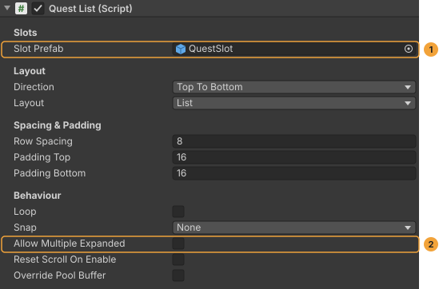

1. **Slot Prefab:** the `QuestSlot` prefab.
2. **Allow Multiple Expanded:** off, so opening a row closes the one that was open, like an accordion. Turn it on to keep several open.

Start it with `list.Initialize(new ListSource<Quest>(quests))`.

### Open to the content's height instead

Leave out the size to let the open slot measure itself, so a long description gets a tall row:

```csharp
Owner.Expand(ItemIndex); // measured: the root needs a layout group that reports the open height
```

For that, give the root a Vertical Layout Group as in [Slots that size themselves](#build-the-prefab). A slot whose `DefaultExtent` is `-1` is always measured: `Expand` and `Collapse` then only switch its state.

**Notes**
- Opening or closing never moves what's on screen above the row.
- `list.ItemExpanded` and `list.ItemCollapsed` tell you which row changed.
- Lists only: grids, bento and looping lists don't expand.

## Looping carousel

**Use it when** cards go round forever and settle on the one in the middle: a character select, a banner rotator.

### The slot, with a scale effect

`IViewportPositionListener` tells a slot where it sits as the list moves: 0 at the centre, -0.5 and +0.5 at the edges. Scale a child, not the root: the list sizes the root.

```csharp
using UIScroller;
using UnityEngine;
using UnityEngine.UI;

public class CarouselCard
{
    public Sprite Art;
}

public class CarouselCardSlot : MonoBehaviour, ISlot<CarouselCard>, IViewportPositionListener
{
    private const float SmallestScale = 0.8f;

    [SerializeField] private RectTransform face;  // a child that holds the visuals
    [SerializeField] private Image art;

    private CarouselCard data;

    public float DefaultExtent => 180f; // card width

    public CarouselCard Data
    {
        get => data;
        set
        {
            data = value;
            art.sprite = value.Art;
        }
    }

    public void OnViewportPosition(float position)
    {
        float distance = Mathf.Clamp01(Mathf.Abs(position) / 0.5f);
        float scale = Mathf.Lerp(1f, SmallestScale, distance);
        face.localScale = new Vector3(scale, scale, 1f);
    }
}

public class CardCarousel : Scroller<CarouselCard>
{
}
```

### The Inspector

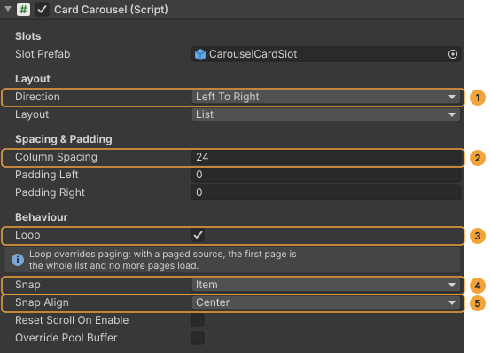

1. **Direction:** Left To Right.
2. **Column Spacing:** 24 between cards.
3. **Loop:** on. The info box is a reminder that a looping list doesn't page.
4. **Snap:** Item, so the list settles on a card after a drag or a flick.
5. **Snap Align:** Center, so that card lines up with the middle. Snap Align only shows for Snap: Item.

### Start it

```csharp
carousel.SnappedTo += index => Debug.Log($"Showing card {index}");
carousel.Initialize(new ListSource<CarouselCard>(cards));
carousel.ScrollToItem(0, ScrollAlign.Center);
```

**Notes**
- Indexes stay real (`0` to `count - 1`) everywhere, and `ScrollToItem` takes the shortest way round.
- You never see the loop jump; drags and flings carry on across it.
- Lists and bento loop; grids, sections and expandable slots don't. Bento carousels: [Bento carousels](scrolling.md#bento-carousels).

### Pager

For onboarding screens or a gallery that moves one full screen at a time, use **Snap: Page** without Loop:

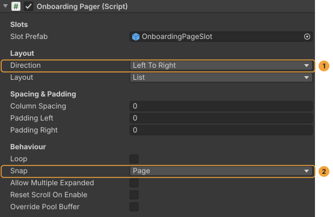

1. **Direction:** Left To Right.
2. **Snap:** Page. A flick goes to the next or previous page, a slow release to the nearest one. Pages always line up with the start.

Make each page slot as wide as the list: return the list's width from `DefaultExtent` (for example `1080f` for a full-width list on a 1080-wide reference resolution).

## Carousels inside a vertical list

**Use it when** a vertical page holds horizontal shelves: a store front, a streaming home screen. Dragging sideways moves a shelf; dragging up or down moves the page.

### The items

Each shelf owns the source of its cards:

```csharp
using UIScroller;

public class Shelf
{
    public string Title;
    public ListSource<ProductCard> Cards;
}

public class ProductCard
{
    public string Name;
}
```

### The shelf slot holds a list

The outer list's slot contains a whole horizontal list. Because shelf slots are reused, give the inner list the new shelf's cards in the `Data` setter: `Initialize` the first time, `SetSource` after, and scroll back to the start for a new row.

```csharp
using TMPro;
using UIScroller;
using UnityEngine;

public class ShelfSlot : MonoBehaviour, ISlot<Shelf>
{
    [SerializeField] private TMP_Text title;
    [SerializeField] private ShelfCarousel carousel;

    private Shelf data;

    public float DefaultExtent => 300f; // title plus the card strip

    public Shelf Data
    {
        get => data;
        set
        {
            data = value;
            title.text = value.Title;

            if (!carousel.IsInitialized)
            {
                carousel.Initialize(value.Cards);
                return;
            }

            carousel.SetSource(value.Cards);
            carousel.ScrollToStart();
        }
    }
}

public class ShelfList : Scroller<Shelf>
{
}

public class ShelfCarousel : Scroller<ProductCard>
{
}
```

**Build the prefab:** a `ShelfSlot` root, a title text at the top, and below it a UI GameObject with the `ShelfCarousel` component, which builds its own Viewport and Content. Give the carousel its card slot prefab (`ProductCardSlot`, an `ISlot<ProductCard>` with a fixed width). Save the whole shelf as one prefab.

### The two Inspectors

The outer list, on the screen:

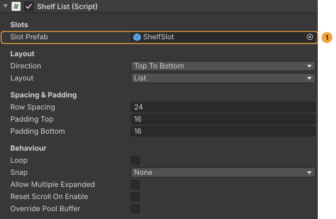

1. **Slot Prefab:** the `ShelfSlot` prefab.

The inner list, inside the shelf prefab:

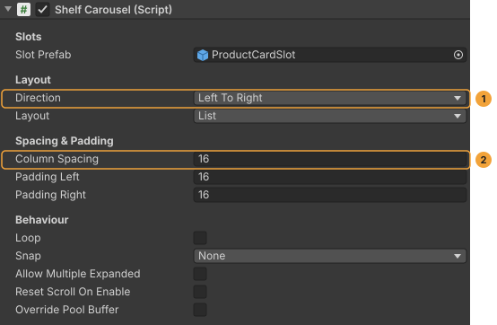

1. **Direction:** Left To Right.
2. **Column Spacing:** 16 between cards.

### Start it

```csharp
shelfList.Initialize(new ListSource<Shelf>(shelves));
```

**Notes**
- The drag goes to the list along its axis: mostly sideways moves the shelf, mostly up or down moves the page. The mouse wheel follows the same rule, and touching a shelf stops the page's fling.
- To keep a list from handing drags to its parent: `list.Settings.passDragsToParent = false`.
- A vertical list inside another vertical list doesn't hand the drag over at its edges yet.
- The **Examples** sample's `NestedExample` builds this in code.
