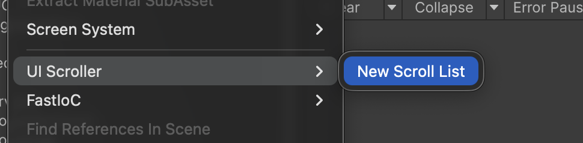
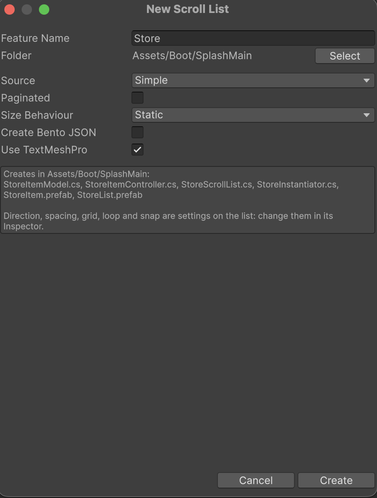

# Getting Started

[← Back to README](../README.md)

- [Requirements](#requirements)
- [Installation](#installation)
- [Samples](#samples)
- [Your first list](#your-first-list)
- [Next steps](#next-steps)

---

## Requirements

| Requirement | Supported |
|---|---|
| Unity | Tested on Unity 2022.3 LTS, Unity 6000.0 LTS and Unity 6000.3. |
| Scripting backend | Mono (Editor) and IL2CPP (Android 32-bit ARMv7 and 64-bit ARM64, iOS ARM64, WebGL) |
| Platforms | macOS Editor; Android (Galaxy A02s, Pixel 2 XL, Pixel 5), iOS (iPhone 13 mini, iPhone Air) and WebGL (Chrome on macOS), each running the full device bench. Desktop players aren't tested yet. |
| UI framework | uGUI only |
| Enter Play Mode with domain reload disabled | Supported and checked: the runtime keeps no static state between plays (its only static field is an internal switch for tests). |
| Dependencies | [Tools Core](https://github.com/sgonzalezrozo/unity-tools-core) and uGUI. The Quick Start and Extras samples use TextMeshPro; the Examples sample doesn't. |

## Installation

Git must be installed on your machine.

### 1. Install Tools Core

UI Scroller needs [Tools Core](https://github.com/sgonzalezrozo/unity-tools-core), the shared code that defines the injection interfaces. Unity doesn't install Git dependencies by itself, so add it first:

1. In Unity, open **Window > Package Manager**.
2. Select **+ > Add package from git URL**.
3. Enter:

```text
https://github.com/sgonzalezrozo/unity-tools-core.git
```

### 2. Install UI Scroller

Same steps, with:

```text
https://github.com/sgonzalezrozo/unity-ui-scroller.git
```

The package itself doesn't need TextMeshPro. The Quick Start and Extras samples use it: it's part of uGUI in Unity 6, and on Unity 2022.3 you install it from the Package Manager.

## Samples

Import them from the package's page in the Package Manager (**Samples** tab):

| Sample | What's in it |
|---|---|
| **Examples** | Eight scenes that build their UI in code: add one to an empty GameObject in an empty scene and press Play. `GridExample`, `BentoExample`, `BentoSectionsExample`, `SectionsExample`, `ExpandableExample`, `CarouselExample` (loop and snap), `NestedExample` (carousels inside a vertical list) and `PagingExample` (paging and pull to refresh). No TextMeshPro needed. |
| **Quick Start** | The scripts for [Simple list with fixed-size slots](examples.md#simple-list-with-fixed-size-slots). |
| **Extras** | A pull-to-refresh indicator and an empty-state panel. |

## Create a list from the Assets menu

Right-click a folder in the Project window and select **UI Scroller > New Scroll List**. The wizard asks only what needs different scripts; everything else (direction, spacing, grid, loop, snap) is a setting in the list's Inspector.

 New Scroll List" width="420"><br>


| Option | Choices |
|---|---|
| **Feature Name** | Prefixes every script and prefab, for example `Store` |
| **Source** | **Simple**: one list of items. **Multisource**: several lists, each under a header |
| **Paginated** | Items arrive a page at a time as you scroll near the end. Simple source only |
| **Size Behaviour** | **Static**: every item the same size. **Dynamic**: each item as big as its content, measured with layout. **Expandable**: items open to a bigger size when their hitbox is tapped |
| **Create Bento JSON** | Turns bento on and creates a layout JSON for the list. Static size only |
| **Use TextMeshPro** | Labels use TextMeshPro when it's installed, Unity's `Text` otherwise |

For `Store` it creates, in that folder:

```
StoreItemModel.cs        the data of one item
StoreItemController.cs   shows one item; reused as you scroll
StoreScrollList.cs       the list component
StoreInstantiator.cs     gives the list its items
StoreItem.prefab         the item template
StoreList.prefab         the list and the instantiator
```

Multisource adds `StoreHeaderModel`, `StoreHeaderController` and `StoreHeader.prefab`; Paginated adds `StorePageLoader`, where your request goes; the bento option adds `StoreLayout.json`. The scripts are written first and the prefabs are built once Unity has compiled them.

Place `StoreList.prefab` under a Canvas and give it your data:

```csharp
[SerializeField] private StoreInstantiator store;

private void Start()
    => store.Show(items); // a list of StoreItemModel
```

Until your code calls `Show`, the instantiator shows **Placeholder Count** made-up items (10), so the list isn't empty the first time you press Play. Set it to 0 once real data comes in. A paginated list's `StorePageLoader` makes up three pages until you replace its `LoadAsync`.

## Your first list

A list takes four pieces:

1. An **item** class with your data.
2. A **slot** prefab whose component implements `ISlot<T>`: it shows one item and is reused as you scroll.
3. A **list** class, `public class InventoryList : Scroller<InventoryItem> { }`, added to a sized UI object under your Canvas. It builds its own Viewport and Content.
4. One call with your items: `list.Initialize(new ListSource<InventoryItem>(items))`.

[Simple list with fixed-size slots](examples.md#simple-list-with-fixed-size-slots) walks through each step, with the scripts, the prefab, the Hierarchy and the Inspector.

## Next steps

- [Examples](examples.md): step-by-step setups for measured slots, grids, bento, sections, tabs, paging, search, expandable rows, carousels and nested lists
- [Data & Sizes](data-and-sizes.md): sources, updates, fixed and measured sizes
- [Layouts](layouts.md) and [Scrolling](scrolling.md): every option, in detail
