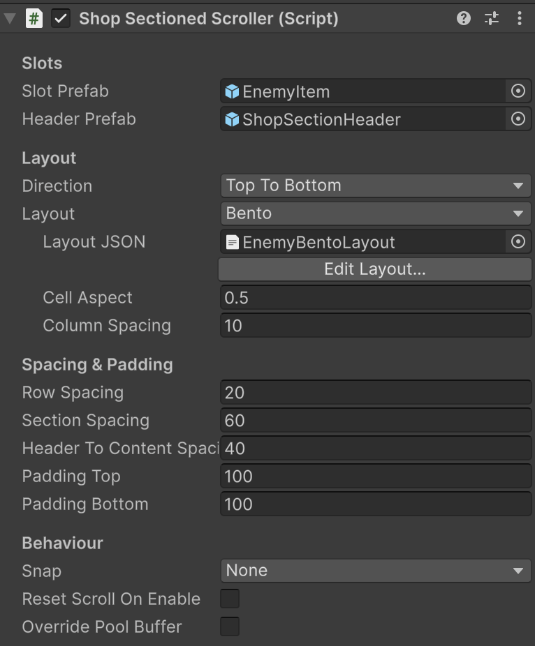

# Layouts

[← Back to README](../README.md)

- [Lists and directions](#lists-and-directions)
- [Grids](#grids)
- [Bento](#bento)
- [Sections and headers](#sections-and-headers)
- [Expandable slots](#expandable-slots)

---

## Lists and directions

Full examples: [vertical list](examples.md#simple-list-with-fixed-size-slots) and [horizontal list](examples.md#horizontal-list).

**Direction** is Top To Bottom, Bottom To Top, Left To Right or Right To Left. Bottom To Top and Right To Left start from the opposite end, as in a list whose newest item sits at the bottom. Every layout works in every direction.

## Grids

Full examples: [Grid with fixed columns](examples.md#grid-with-fixed-columns) and [Auto grid](examples.md#auto-grid).

Set **Layout** to:
- **Grid** for a fixed number of columns (rows in a horizontal list);
- **Auto Grid** for as many as the width allows, from a target slot size, between a minimum and a maximum.

Slots stretch to fill the line. The space between slots on a line is **Column Spacing** (**Row Spacing** in a horizontal list).

From code, before `Initialize`: `list.Settings.slotsPerLine = 3` for a fixed grid, or `list.Settings.autoSlotsPerLine = true` with `targetSlotSize` (and optionally `minSlotsPerLine` and `maxSlotsPerLine`).

## Bento

Full example: [Bento store](examples.md#bento-store).

Bento places tiles of different sizes on a grid of cells: a big featured tile, a strip of small ones, a tall one beside two stacked. Set **Layout** to **Bento** and give the list a **Layout JSON** (a TextAsset), or set it from code. Items don't choose their size: the layout does.

**Edit Layout** (or **New Layout**) next to the field opens the **Bento Layout Editor** (also under Window > UI Scroller): draw each pattern's tiles on a grid, or list the spans, and see the first items placed as you go. It saves the same JSON.

A layout is either:
- **spans**, a sequence of tile sizes packed in order: each tile goes in the first gap where it fits, without going back to fill earlier holes;
- or **patterns**, blocks of cells drawn tile by tile.

Both repeat from `repeatFrom` after their last entry.

```json
{
  "columns": 4,
  "repeatFrom": 1,
  "patterns": [
    { "rows": 2, "tiles": [ {"c":0,"r":0,"w":2,"h":2}, {"c":2,"r":0,"w":2,"h":1}, {"c":2,"r":1,"w":1,"h":1}, {"c":3,"r":1,"w":1,"h":1} ] },
    { "rows": 1, "tiles": [ {"c":0,"r":0,"w":1,"h":1}, {"c":1,"r":0,"w":1,"h":1}, {"c":2,"r":0,"w":1,"h":1}, {"c":3,"r":0,"w":1,"h":1} ] }
  ]
}
```

```json
{ "columns": 4, "repeatFrom": 1, "spans": [ {"w":2,"h":2}, {"w":1,"h":1} ] }
```

```csharp
list.Settings.bento = true;
list.Settings.cellAspect = 1f;                    // row height / column width
list.SetBentoLayout(BentoLayout.FromJson(json));  // or BentoLayout.FromSpans / FromPatterns
list.Initialize(source);
```

- Columns come from the layout. The column width comes from the list's width and **Column Spacing**, and the row height from **Cell Aspect**. Tiles stretch to their cells.
- **Every layout is checked.** A broken one logs its errors (the inspector lists them too) and places items as 1x1 tiles. `layout.Errors` has them in code.
- Paging works: new pages continue the layout without moving what's on screen.
- `SetBentoLayout` after `Initialize` rebuilds with the new layout. `GetTile(index)` tells you where an item sits.
- Another JSON library can fill `BentoLayoutData` for `BentoLayout.FromData`.
- Tiles don't expand. A bento list can loop: see [Bento carousels](scrolling.md#bento-carousels).

## Sections and headers

Full example: [Several sources in one list](examples.md#several-sources-in-one-list-sections), with a [bento variant](examples.md#bento-sections).

For a list split into sections, each with a header, use `SectionedScroller<TItem, THeader>` with a `SectionedSource<TItem, THeader>`. Each section is a header plus its own source of items:

```csharp
public class InventorySection
{
    public string Title;
}

// The header slot, on the Header Prefab. -1 measures it, so each header can be as tall as its own content.
public class InventoryHeaderSlot : MonoBehaviour, ISlot<InventorySection>
{
    [SerializeField] private TMP_Text title;

    private InventorySection data;

    public float DefaultExtent => -1f;

    public InventorySection Data
    {
        get => data;
        set
        {
            data = value;
            title.text = value.Title;
        }
    }
}

public class InventorySectionsList : SectionedScroller<InventoryItem, InventorySection>
{
}
```

Assign **Slot Prefab** and **Header Prefab**, then build the sections. A sectioned list adds **Header Prefab**, **Section Spacing** and **Header To Content Spacing** to the Inspector:



```csharp
SectionedSource<InventoryItem, InventorySection> source = new();
source.AddSection(new InventorySection { Title = "Weapons" }, new ListSource<InventoryItem>(weapons));
source.AddSection(new InventorySection { Title = "Potions" }, new ListSource<InventoryItem>(potions));

list.SetSource(source); // starts the list the first time, replaces the sections after that
```

- **Headers** follow the same size rule as slots: a positive `DefaultExtent` is fixed, 0 or less is measured. Measured headers can each have a different height.
- **Section Spacing** adds space before every header except the first, and **Header To Content Spacing** adds space between each header and its section's first line.
- **In a grid or bento,** a header takes a whole row and each section starts a new row. In bento, the layout starts again in each section, and a tall tile never reaches into the next section.
- **Empty sections are skipped**, header included. Set `source.SkipEmptySections = false` to show the header of an empty section.
- `InsertSection`, `RemoveSection` and `ClearSections` change the sections. After changing a section's own source, call `list.Refresh()`.
- `list.ScrollToSection(index, duration)` goes to a section's header (or the next section shown, if that one is empty).
- **Indexes in the list's API count headers.** `source.FlatIndexOf(section, indexInSection)` gives an item's index, `source.FlatIndexOf(section, -1)` its header's, and `source.Locate(index)` goes the other way.
- `ISectionedSourceProvider<TItem, THeader>` builds the source elsewhere: call `list.SetSource(provider)`.
- A sectioned list doesn't page.

## Expandable slots

Full example: [Expandable rows](examples.md#expandable-rows).

Implement `IExpandableSlot<T>`. The list sets `Owner` and `ItemIndex` every time it binds the slot, and `IsExpanded` after `Data`:

```csharp
public class ExpandableInventorySlot : MonoBehaviour, IExpandableSlot<InventoryItem>
{
    [SerializeField] private TMP_Text label;
    [SerializeField] private GameObject details;

    private InventoryItem data;
    private bool isExpanded;

    public float DefaultExtent => 80f;
    public IScroller Owner { get; set; }
    public int ItemIndex { get; set; }

    public InventoryItem Data
    {
        get => data;
        set
        {
            data = value;
            label.text = value.Name;
        }
    }

    public bool IsExpanded
    {
        get => isExpanded;
        set
        {
            isExpanded = value;
            details.SetActive(value);
        }
    }

    // Hook this up to the slot's button.
    public void Toggle()
    {
        if (IsExpanded)
            Owner.Collapse(ItemIndex);
        else
            Owner.Expand(ItemIndex);
    }

    // Called when the list closes this slot because another one opened.
    public void OnCollapsed()
        => IsExpanded = false;
}
```

- **Fixed-size slots** (`DefaultExtent` above 0), the usual case: closed, the slot keeps its fixed size and nothing is measured while scrolling.
  - `Expand(index)` without a size measures the open slot in Unity's own layout pass, so it grows on the frame after the tap. It follows its details while open, including late text. The root needs a layout group (or a `LayoutElement`) that reports the open height; without one it opens to twice its size.
  - `Expand(index, 240f)` opens it to a fixed size. `SetExpandedSize(index, size)` resizes an open slot.
- **Measured slots** (`DefaultExtent` of 0 or less) size themselves: `Expand` and `Collapse` only change the state, and the slot is measured with its details on or off. A size passed to `Expand` is ignored, with a warning.
- Opening or closing never moves what's on screen above the item.
- **Allow Multiple Expanded** keeps more than one open.
- Lists only: grids and bento don't expand, because opening one slot would change the others on its row.
