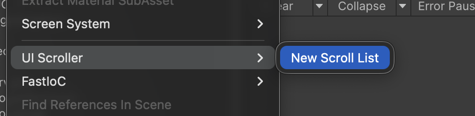
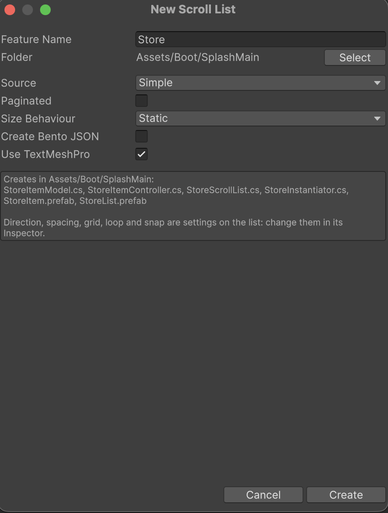

<div align="center">

# Unity UI Scroller

<sub>DESIGNED & BUILT BY</sub><br>
**✦ [`SANTIAGO GONZÁLEZ ROZO (@sgonzalezrozo)`](https://github.com/sgonzalezrozo) ✦**

A recycling (virtualized) scroll view for uGUI: lists, grids and bento layouts of any length, costing only what's on screen. Zero allocations scrolling 100,000 items on phones and WebGL.

[](Documentation~/getting-started.md#requirements)
[](CHANGELOG.md)
[](LICENSE)

[**Installation**](#installation) • [**Key Features**](#key-features) • [**Quickstart**](#quickstart) • [**Examples**](Documentation~/examples.md) • [**Layouts**](Documentation~/layouts.md) • [**Scrolling**](Documentation~/scrolling.md) • [**API Reference**](Documentation~/api-reference.md)

<sub>[Getting Started](Documentation~/getting-started.md) • [Data & Sizes](Documentation~/data-and-sizes.md) • [Performance](Documentation~/performance.md) • [AI Agents](Documentation~/ai-agents.md) • [Troubleshooting](Documentation~/troubleshooting.md) • [FAQ](Documentation~/faq.md) • [Project Status](Documentation~/project-status.md)</sub>

</div>

---

## Installation

UI Scroller depends on [Tools Core](https://github.com/sgonzalezrozo/unity-tools-core). Unity doesn't install Git dependencies automatically, so add both, in this order:

1. Open **Window > Package Manager** in Unity.
2. Click **`+`** in the top-left corner and select **Add package from git URL...**
3. Paste each URL below and click **Add**:

```text
https://github.com/sgonzalezrozo/unity-tools-core.git
```

<sub>* Tools Core is needed only by Screen System, Fast IoC and UI Scroller. Add it once, even if you use several of them.</sub>

```text
https://github.com/sgonzalezrozo/unity-ui-scroller.git
```

> **Wait for each package to compile.** Add the first URL, wait until Unity finishes importing and compiling, then add the next. Adding a package while Unity is still importing the previous one can log `ScriptableSingleton already exists` and `assets located in immutable packages were unexpectedly altered`. They don't block anything: clear the Console and continue. If they come back when you open the project without adding a package, report it.

There's nothing to set up after installing. Requirements, tested platforms and samples: [Getting Started](Documentation~/getting-started.md).

**Assembly references.** If your code is in an assembly definition (`.asmdef`), add `UIScroller` and `ToolsCore` to its **Assembly Definition References**. Unity doesn't add them for you, and without them the build fails with `CS0246`. **New Scroll List** adds them to the folder's `.asmdef` when it writes its scripts.

---

## Key Features

* **[Every layout a game screen needs](Documentation~/layouts.md)**: [vertical](Documentation~/examples.md#simple-list-with-fixed-size-slots) and [horizontal](Documentation~/examples.md#horizontal-list) lists in both directions, [fixed](Documentation~/examples.md#grid-with-fixed-columns) and [automatic](Documentation~/examples.md#auto-grid) grids, and [**bento**](Documentation~/examples.md#bento-store) tiles of different sizes described in JSON.
  [Sections with headers](Documentation~/examples.md#several-sources-in-one-list-sections) of any height, and [expandable accordion slots](Documentation~/examples.md#expandable-rows).
* **[Sizes the way you build slots](Documentation~/data-and-sizes.md#item-sizes)**: a [fixed size](Documentation~/examples.md#simple-list-with-fixed-size-slots), or the [slot's own Unity layout](Documentation~/examples.md#slots-that-size-themselves), measured once and cached, with no `ContentSizeFitter`.
  Late text is followed without code, and what's on screen never jumps, even mid-drag.
* **[Scrolling that feels right](Documentation~/scrolling.md)**: scroll to any item, snap to items or [pages](Documentation~/examples.md#pager), [looping carousels](Documentation~/examples.md#looping-carousel) (bento ones too), and [nested scrolling](Documentation~/examples.md#carousels-inside-a-vertical-list) that hands drags to the right list.
* **[Data from anywhere](Documentation~/data-and-sizes.md#data-and-updates)**: [pages that load as you scroll](Documentation~/examples.md#infinite-scroll-with-paging), [several sources in one list](Documentation~/examples.md#several-sources-in-one-list-sections), [tabs](Documentation~/examples.md#switching-between-sources-tabs), [search](Documentation~/examples.md#search-and-filter) and [live updates](Documentation~/examples.md#updating-items-at-runtime), without a rebuild.
* **[Built for phones](Documentation~/performance.md)**: scrolling allocates nothing, pooled slots stay active out of view, and the Viewport's nested Canvas rebatches only the list.

---

## Quickstart

The fastest start: right-click a folder in the Project window and select **UI Scroller > New Scroll List**. Name the feature, pick its source and size behaviour, and click **Create**: you get the scripts, split into Model, View and Controller, and the `StoreItem` and `StoreList` prefabs, wired and ready for your data through `StoreListModel`. See [Create a list from the Assets menu](Documentation~/getting-started.md#create-a-list-from-the-assets-menu).

 New Scroll List" width="420"><br>


By hand, in three steps:

1. Add a slot (`ISlot<T>`) and a list class (`Scroller<T>`).
2. Add the list to a sized UI object under your Canvas; it builds its Viewport and Content. Assign the slot prefab.
3. Give it your items:

```csharp
list.Initialize(new ListSource<InventoryItem>(items));
```

<details>
<summary><strong>View full sample script</strong></summary>

```csharp
using System.Collections.Generic;
using TMPro;
using UIScroller;
using UnityEngine;

public class InventoryItem
{
    public string Name;
}

// On the slot prefab's root. Slots are reused: reset every visual in the Data setter.
public class InventorySlot : MonoBehaviour, ISlot<InventoryItem>
{
    [SerializeField] private TMP_Text label;

    private InventoryItem data;

    // A fixed height of 80 px. Return -1 to size each slot from its layout instead.
    public float DefaultExtent => 80f;

    public InventoryItem Data
    {
        get => data;
        set
        {
            data = value;
            label.text = value.Name;
        }
    }
}

// Unity can't add an open generic component, so make a concrete class.
public class InventoryList : Scroller<InventoryItem>
{
}

public class InventoryScreen : MonoBehaviour
{
    [SerializeField] private InventoryList list;

    private void Start()
    {
        List<InventoryItem> items = new();
        for (int i = 0; i < 10_000; i++)
            items.Add(new InventoryItem { Name = $"Item {i}" });

        list.Initialize(new ListSource<InventoryItem>(items));
    }
}
```

</details>

The full walkthrough, with the prefab, the Hierarchy and the Inspector, is in [Simple list with fixed-size slots](Documentation~/examples.md#simple-list-with-fixed-size-slots). [Examples](Documentation~/examples.md) has the same for every other setup.
